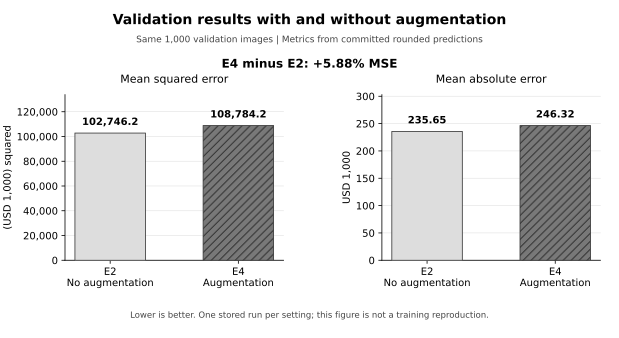

# Phase 3 - Augmentation Comparison and Verification

**Course:** COMP90086 Computer Vision, 2026 Semester 2  
**Project:** Predicting House Prices  
**Member A / document owner:** Mingyang Sun (1657392)  
**Member B / reviewer:** Yikai Qian (1722421); review not yet recorded  
**Prepared:** 12 October 2026 | **P05 internal deadline:** 12 October 2026  
**Repository inspected:** `main @ 4ba5d22751a529ac7f4ec56947ea86d7cb531159`

**Status:** Member A's augmentation analysis and verification handoff are complete within the available evidence. The existing implementation and committed validation predictions were reviewed. Recalculation shows that E4 has **5.88% higher validation MSE than E2**. The matching original training logs, model files and Member B's review remain pending. This document does not claim a new training run or complete recovery of the original experiments. [R1-R4, E1]

## 1. Scope and responsibility

The project plan assigns Member A the P05 task to compare moderate data augmentation against the approach without augmentation. Member B compares partial network fine-tuning against frozen features. P05 requires experiment configurations, logs, saved models and validation MSE on the same split. Its internal deadline is 12 October 2026. [S1, p. 1, P05]

The repository already includes both relevant runs: **E2_finetune**, without augmentation, and **E4_augment**, with augmentation. This handoff records their shared settings, explains the augmentation policy, verifies the committed prediction files and evaluates the observed difference. It preserves the existing split, model implementation and historical predictions. Existing implementation is credited to the shared project; this document does not claim that Member A newly trained these runs. [R1-R4]

E2 is the direct comparison for E4 because both use the same fine-tuning method and 224-pixel input. The Phase 2 Ridge baseline uses a different regression head and fitting method. The broader model comparison and selection belong to P06, due 16 October; error analysis belongs to P07, due 18 October; report preparation belongs to P08, due 21 October. This working record supports those later tasks without replacing them. [R1, R4, S1]

### Phase 2 work already completed

The latest committed Phase 2 audit records **30 PASS, 0 FAIL and 3 PENDING**. It already checked the supplied baseline results log, saved target statistics, source-label coverage and the baseline submission's schema and test-ID order. Its remaining artifact checks concern `x_scaler.joblib`, `ridge.joblib` and `mlp.keras`. The earlier Phase 2 document describes an older evidence state; the completed log and target-statistics checks do not need to be repeated for this handoff. No Phase 2 or Phase 3 teammate approval is inferred from the recorded Phase 1 approval. [R5]

## 2. Shared experimental settings

The following table records the inspected configuration and code. It establishes the intended E2/E4 comparison; the original logs are still needed to confirm each historical run's settings and execution details. [R1-R2]

| Item | Shared E2 / E4 setting |
|---|---|
| Labelled source and split | Existing 7,000 training / 1,000 validation records from 8,000 labelled examples |
| Split policy | Committed CSVs; price-decile stratification; validation fraction 0.125 |
| Random seed | 42 |
| Target and units | One house price, in USD 1,000 |
| Backbone | ImageNet-pretrained ResNet-50; `include_top=False`; global average pooling |
| Backbone adaptation | Final `conv5` stage marked trainable; earlier backbone layers frozen |
| Backbone call | `base(inputs, training=False)` in both configurations |
| Regression head, in order | `Dropout(0.2) -> Dense(256, relu) -> Dense(1)` |
| Input | JPEG decoded as three channels; resized to 224 x 224 |
| Backbone preprocessing | `keras.applications.resnet50.preprocess_input` |
| Training target | Standardised with the training mean and population standard deviation |
| Optimiser and loss | Adam, learning rate 0.0001; MSE on standardised prices |
| Batch and ordering | Batch size 32; training shuffled with seed 42 and reshuffled each epoch |
| Epoch budget | Default cap of 15 epochs |
| Early stopping | Monitor `val_loss`; patience 4; restore the best weights |
| Validation processing | No augmentation; no training shuffle |
| Evaluation | Reverse target scaling; clip to training-label bounds 195 to 2,000; calculate MSE, MAE and R2 |
| Intended comparison | E2: no augmenter; E4: the five-operation policy in section 3 |

Training statistics are calculated from the training labels, not from validation labels or the sample submission. The inspected fine-tuning module does not load the test set. The existing split files define the evaluation population; they must not be regenerated to improve this comparison. [R1-R2]

The same global seed does not guarantee identical initial head weights or identical random choices. E4 creates random augmentation layers before the regression head, which can change the order in which random seeds are consumed. The evidence therefore describes one stored run per configuration, with a shared configured seed. It does not establish an isolated causal effect under identical initial weights. [R1]

## 3. Moderate augmentation policy

E4 applies the following layers in the listed order. Constructor values are recorded exactly as they appear in `build_augmenter()`. [R1]

| Order | Operation and exact configuration | Reason for inclusion |
|---|---|---|
| 1 | `RandomFlip("horizontal")` | Vary left-right presentation of the house exterior |
| 2 | `RandomTranslation(0.1, 0.1)` | Vary horizontal and vertical framing with moderate translation factors |
| 3 | `RandomZoom(0.1)` | Vary the apparent image scale with a moderate zoom factor |
| 4 | `RandomBrightness(0.15, value_range=(0.0, 255.0))` | Vary brightness within the configured image-value range |
| 5 | `RandomContrast(0.15, value_range=(0.0, 255.0))` | Vary contrast within the configured image-value range |

These operations aim to reduce sensitivity to framing and lighting differences while retaining useful exterior features. They assume that a moderate transformation keeps the original sale-price label appropriate. That assumption is a design choice, including for horizontal flipping; it is not a verified statement that every transformed image preserves all useful price cues. The source images and augmented image samples were not inspected in this verification. [R1, S2]

The processing order is **decode -> resize -> optional augmentation -> ResNet-50 preprocessing**. The training pipeline receives the augmenter and calls it with `training=True`. The validation pipeline is constructed without the augmenter. Therefore, the inspected code applies the policy to training data only. This is a source-code finding, not a new execution of the image pipeline. [R1]

All five operations were enabled together in E4. The stored results compare that complete policy with no augmentation. They do not identify the effect of flipping, translation, zoom, brightness or contrast separately. No additional augmentation experiment is invented in this record.

## 4. Verification method and evidence

The read-only checker uses the committed training and validation split CSVs and the two committed validation prediction CSVs. It checks identifiers and labels, aligns predictions by `imageid`, and recalculates metrics from `price_pred`. The prediction files are sorted separately by error, so their row positions cannot be used to pair E2 with E4. [R2-R3, E1]

For each validation image, let `y` be its label in `val_split.csv`, and `p` its stored prediction:

`MSE = mean((p - y)^2)`  
`MAE = mean(abs(p - y))`  
`R2 = 1 - sum((p - y)^2) / sum((y - mean(y))^2)`

The verification recalculates errors from predictions and authoritative split labels; it does not use the rounded `residual` or `abs_error` columns to calculate model scores. It reads no house images, loads no model, runs no training and verifies no Kaggle score. [R3, E1]

| Executed CSV finding | Result |
|---|---|
| Validation rows | 1,000 in E2 and 1,000 in E4 |
| Unique validation identifiers | 1,000 in each file |
| Missing or extra validation IDs | 0 in either file |
| `price_true` versus committed validation labels | Exact numerical agreement |
| Pairing | Same validation IDs, joined by identifier |
| E2 prediction range | 195.0 to 1,542.0 |
| E4 prediction range | 195.0 to 2,000.0 |

**Executed audit result:** **19 PASS, 0 FAIL and 5 PENDING**. The pending entries are the two original run logs, the two checkpoint inventories and the shared-run-condition check that depends on both logs. The machine-readable record includes individual checks and input-file identities. Missing original run artifacts are marked `PENDING`; a successful CSV check is not proof that a checkpoint was loaded or that the historical training run has been reproduced. Member B's review is a separate handoff item, not one of these automated checks. [E1]

The complete existing checker suite also passed: **37 tests**, comprising the 17 existing Phase 2 tests and 20 new Phase 3 tests, on Python 3.12.14. The tests cover ID order, missing or duplicate records, incorrect labels, non-finite values, rounding consistency, original-log settings and history, and output protection. They use synthetic fixtures and do not train models. The executed output is retained in `docs/evidence/phase3_checker_tests_2026-10-12.txt`. [E4]

## 5. Results

### 5.1 Recomputed from committed validation predictions

| Configuration | Validation MSE | Validation MAE | Validation R2 |
|---|---:|---:|---:|
| E2: 224px, no augmentation | 102,746.219475 | 235.650414 | 0.334651 |
| E4: 224px, moderate augmentation | 108,784.236328 | 246.318624 | 0.295551 |

E4 minus E2 is **6,038.016853 MSE**, calculated on the same 1,000 validation records. Relative to E2, this is **5.876632% higher MSE**, rounded to **5.88%**. Lower MSE is better, so the no-augmentation run performs better in this comparison. MAE and R2 support the same ordering. MSE is in squared target units; MAE is in USD 1,000; R2 has no unit. [E1]

E4 has lower absolute error on **470** images; E2 has lower absolute error on **529**; **1** image ties. This is a descriptive paired count, not a significance test. E4 improves some predictions, but those improvements do not produce a lower overall validation MSE. [E1]



*Figure 1. E2 and E4 comparison generated from the committed validation predictions. The values describe these stored runs on the fixed validation split. [E2]*

### 5.2 Relationship to the historical experiment log

| Run | MSE in the historical experiment document | MSE recalculated from the committed CSV |
|---|---:|---:|
| E2 | 102,745.7 | 102,746.219475 |
| E4 | 108,784.5 | 108,784.236328 |

The export code rounds `price_pred` to one decimal place, while the training code calculates metrics before that export rounding. The recomputed values therefore need not equal the historical values exactly. The small differences are consistent with rounding, but the missing original logs prevent a complete check of their provenance. The historical scores remain a separate record; this supplement does not overwrite them or present its CSV arithmetic as a new model run. [R1, R3-R4, E1]

## 6. Interpretation and decision for Member A's task

**The moderate augmentation policy did not improve validation MSE in the recorded E2/E4 comparison.** This finding completes the available comparison required of Member A under P05. An improvement experiment can provide a useful negative result; there is no basis to report an augmentation benefit that the available predictions do not show. [S1, E1]

The shared 15-epoch cap provides a valid comparison under a fixed training budget. It does not answer whether either configuration would perform better after a longer schedule. The historical document reports best epochs of 12 for E2 and 14 for E4, but the original per-epoch histories are not committed. Those reported positions alone do not prove that E4 was still improving at the end or that extra epochs would reverse the result. [R4]

Slower optimisation under augmented inputs is one possible explanation. Loss of useful visual details or variation between training runs are also possible. None is established by the stored predictions. In addition, training loss measured on augmented inputs is not directly the same task as training loss measured on unchanged inputs. It should not be used alone to claim slower learning or less overfitting.

There is one stored run per condition, the five transformations were changed together, and a shared configured seed does not establish identical initialisation. The result should therefore remain limited to this policy and these runs. It does not show that augmentation is generally harmful. A future comparison could preserve initial weights, use separate augmentation seeds, repeat both conditions and test a longer budget. Such follow-up is not recorded as completed work here.

For the augmentation question, retain E2 as the stronger measured condition and record E4's negative result. This decision does not select the final project model or reverse an existing ensemble result. P06 can use the verified comparison alongside other experiments when making the broader selection. [S1]

## 7. Artifacts and remaining handoff

| Artifact or action | Current state and next step |
|---|---|
| Existing E2/E4 implementation and settings | Reviewed in `src/exp_finetune.py`; configuration recorded above |
| E2/E4 validation predictions | Present; checked against the committed validation split |
| Read-only checker and executed evidence | Supplied in `tools/verify_phase3_augmentation.py` and `docs/evidence/phase3_augmentation_audit_2026-10-12.json` |
| `outputs/logs/phase3_E2_finetune.json` | Pending: obtain the matching original E2 log from the run owner |
| `outputs/logs/phase3_E4_augment.json` | Pending: obtain the matching original E4 log from the run owner |
| `outputs/models/finetuned_E2_finetune.keras` | Pending: preserve the matching original E2 checkpoint and its accessible location |
| `outputs/models/finetuned_E4_augment.keras` | Pending: preserve the matching original E4 checkpoint and its accessible location |
| Member B review | Pending: review the configuration, calculated comparison and remaining artifact status; record the actual outcome and date |

The existing ignore rules exclude training logs and model files from normal Git tracking. Small authentic logs can be archived under `docs/evidence/`; large checkpoints can be retained in the team's agreed shared location. File presence alone does not prove checkpoint validity or prediction provenance. The checker does not load or execute supplied models. [R6, E1]

Do not recreate missing histories from the summary table or rerun training under an old tag merely to fill the record. First preserve the matching original files. Any later rerun should have a new tag and its own results, code revision, split identities, package versions and runtime information. Member A's completed analysis is distinct from the outstanding shared obligation to preserve the original P05 logs and models. [S1]

### Re-run the CSV verification

From the repository root, use this one-line PowerShell command. It creates a new timestamped evidence file:

```powershell
python tools/verify_phase3_augmentation.py --repo-root . --out ("docs/evidence/phase3_augmentation_audit_{0}.json" -f (Get-Date -Format "yyyyMMdd_HHmmss_fff"))
```

The verifier needs Python and the committed CSVs; it does not require the local house-image dataset or TensorFlow. The output path must be new. To inspect matching artifacts stored elsewhere, use the optional `--e2-log`, `--e4-log`, `--e2-model` and `--e4-model` arguments. Add `--require-artifacts` when missing original artifacts should produce a nonzero exit status. Read the reported pending items even when the CSV checks pass.

The normal exit codes are **0** when all available checks pass, **1** when a check fails or an input/output error occurs, and **2** when `--require-artifacts` is requested but original evidence is still pending. Even a zero exit code does not claim a training reproduction or a completed teammate review.

Run the checker tests with:

```powershell
python -m unittest discover -s tests -p "test_verify_phase3_augmentation.py" -v
```

The saved figure is supplied in SVG and PDF. To regenerate it from an audit with no failed checks, choose a new output directory:

```powershell
python tools/plot_phase3_augmentation.py --audit docs/evidence/phase3_augmentation_audit_2026-10-12.json --out-dir phase3_figures_local
```

Figure generation uses `matplotlib` from the existing requirements. It reads the audit and creates the two result plots; it does not generate a training curve. The [source review](evidence/phase3_source_review_2026-10-12.json) records the inspected code identities and separates source findings from executed CSV checks. [E3]

### Report-ready paragraph

We compared moderate data augmentation with no augmentation using the existing E2 and E4 runs. Both configurations used an ImageNet-pretrained ResNet-50 with partial fine-tuning, a 224 x 224 input, and the same committed split of 7,000 training and 1,000 validation examples. E4 applied horizontal flipping, translation, zoom, brightness changes and contrast changes to training images only. The policy assumed that moderate changes preserved the house-price label. We aligned the committed validation predictions by image identifier and recalculated the metrics against the split labels. E2 achieved MSE 102,746.22, MAE 235.65 and R2 0.335. E4 achieved MSE 108,784.24, MAE 246.32 and R2 0.296. E4 therefore had 5.88% higher MSE, so augmentation did not improve this recorded comparison. The small differences from the historical experiment table are consistent with prediction rounding during CSV export. This result is limited to one run per configuration and the combined augmentation policy. A shared global seed does not ensure identical initial weights, and the original training histories were unavailable for this verification. Slower optimisation is a possible explanation, but the evidence does not establish the cause or show whether a longer schedule would help. We retain the negative result for the later model comparison. [R1-R4, E1]

## Source and evidence register

Repository references describe the inspected source at **`4ba5d22751a529ac7f4ec56947ea86d7cb531159`**. Newly generated evidence is identified separately.

- **[S1]** `COMP90086_Project_Planning(2).pdf`, supplied project plan, p. 1, P05; P06-P08 responsibility and schedule entries. P05 assigns Member A the moderate-augmentation comparison and sets the 12 October deadline.
- **[S2]** `COMP90086_2026_Project.pdf`, supplied assignment specification. This document is a working verification record; the separate final report must follow the specification's limit of four A4 content pages, with references permitted on a fifth page.
- **[R1]** `src/exp_finetune.py`: E2/E4 settings, model and head order, augmentation, target scaling, training/validation pipelines, and log/model filenames.
- **[R2]** `config.py`, `data/splits/train_split.csv`, `data/splits/val_split.csv` and `data/splits/split_meta.json`: configured seed, paths and fixed split.
- **[R3]** `outputs/predictions/val_predictions_E2_finetune.csv`, `outputs/predictions/val_predictions_E4_augment.csv`, `src/error_analysis.py` and `src/metrics.py`: stored predictions, export rounding and metric definitions.
- **[R4]** `docs/experiments.md`: historical E2/E4 summary, recorded scores and reported best epochs; the original logs are not present in the inspected repository.
- **[R5]** `docs/evidence/phase2_baseline_audit_20261009_200414.json`, created 9 October 2026 at 09:04:25 UTC; `docs/Phase2_Verification.md`; `docs/Phase1_Verification.md`: latest Phase 2 evidence, earlier dated documentation and the separately recorded Phase 1 approval.
- **[R6]** `.gitignore`: handling of generated logs, checkpoints, images and prediction CSVs.
- **[E1]** `docs/evidence/phase3_augmentation_audit_2026-10-12.json`: executed read-only verification, input identities and calculated metrics, produced by `tools/verify_phase3_augmentation.py`.
- **[E2]** `docs/figures/phase3_augmentation_comparison.svg`: figure generated from the same committed validation predictions; no additional training or test-set result.
- **[E3]** `docs/evidence/phase3_source_review_2026-10-12.json`: source inspection, configured comparison, export precision and limitations; includes exact source-file identities.
- **[E4]** `docs/evidence/phase3_checker_tests_2026-10-12.txt`: actual output of the complete 37-test evidence-checker suite; synthetic checker tests only.

Pinned source: [repository snapshot 4ba5d22](https://github.com/mingyang-sun1/computer-vision-final-assignment/tree/4ba5d22751a529ac7f4ec56947ea86d7cb531159).
