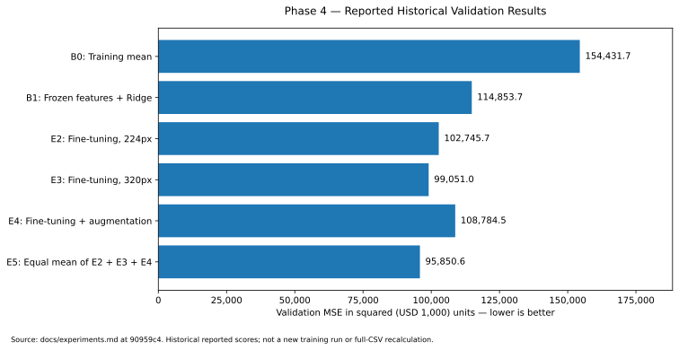

# Phase 4 — Model Comparison and Selection

**Project:** COMP90086 Computer Vision — Predicting House Prices  
**Plan:** revised Phase 1–8 plan following planning feedback; not the earlier P01–P10 plan  
**Phase 4 target:** 16 October 2026  
**Member A:** Mingyang Sun — comparison, evidence review and figures  
**Member B:** Yikai Qian — experiment provenance, necessary final controlled results and joint selection  
**Reference commit:** `90959c41384c7bd3c8c5a48147e8272246071bbe`  
**Prepared:** 16 October 2026  
**Status:** Member A source-based comparison and selection write-up prepared. Fresh full-CSV execution and joint model approval remain to be recorded.

## 1. Repository state checked first

The live repository inspection found only the `main` branch at the reference
commit, which merged Phase 3 PR #3 on 14 October. The open-PR collection was
empty. This describes the remote snapshot, not either member's local
working tree. The snapshot has not advanced since the previous Phase 4
handoff. Its `docs/experiments.md` still ends with a Phase 4 placeholder. [R1]

The E2/E3/E4 validation CSVs, their test submissions, the existing ensemble
submission, and the V3 validation CSV are committed. `outputs/` contains
only the tracked `predictions/` directory; the absence of logs/checkpoints
from GitHub is not evidence that Member B never supplied them. Phase 3's
13 October supplement already records the E2/E4 originals. Phase 3 is not
reopened in this task. [R2–R4]

## 2. Comparison protocol

Use the committed 7,000/1,000 training/validation split. Join predictions
by **imageid**, never by row position: per-model validation exports may be
sorted independently. Validate each true price against `val_split.csv`.
Use validation MSE for selection; MAE and R2 provide supporting detail.
Do not read test labels, tune on Kaggle scores, or search new ensemble
weights in this task. [R2–R3]

Keep three evidence levels separate: historical rounded document scores;
previously supplied training logs; and scores newly computed from stored
prediction CSVs. The exports are rounded, so full-precision training scores
cannot be reconstructed exactly from them. The historical E3 row is
99,051.0, while the E5 source comparison uses 99,051.2; neither should be
silently rewritten as a newly executed score. [R3–R5]

The full historical comparison has eleven numerical rows, covering the
mean predictor, Ridge/MLP baselines, resolution variants, E2/E3/E4 and E5.
[View the comparison](tables/Phase4_Comparison.md).

## 3. Selection and rationale

**Recommend retaining the existing E2 + E3 + E4 equal-weight ensemble.**
Among the fully documented core rows, its reported validation MSE is
**95,850.6**. The reported E3 single-run MSE is **99,051.0** and B1's MSE is
**114,853.7**. These historical values imply **3.23%** lower MSE than E3
and **16.55%** lower than B1. No new training or independent full-CSV
recalculation is claimed for those numbers. [R3]

The ensemble combines already produced predictions, so it does not require
a new backbone or a newly designed training experiment. Equal weights
preserve the existing implementation rather than adding a weight search.
E4 being weaker alone does not imply it must be excluded: the relevant
quantity is the error of the combined predictions. The recorded result
supports this specific ensemble, not a universal benefit from augmentation
or independent model errors. [R3, R5]



*Figure 1. Historical reported validation MSE from the inspected experiment
log. This is not a new training run or a newly executed full-CSV audit.*

This remains a **recommendation awaiting A/B review**. The local audit
also checks both existing V3 columns. A better unidentified V3 result stops
automatic recommendation and requires its original model/run evidence;
its column names alone do not establish the backbone or preprocessing.
Missing numerical results for other README-only experiments are not invented.

## 4. Final configuration to review

| Item | Existing candidate |
|---|---|
| Model | E5: equal mean of E2, E3 and E4 |
| Component tags | `E2_finetune`, `E3_320px`, `E4_augment` |
| Weights | 1/3 each; no new weight tuning |
| Core backbone | ImageNet-pretrained ResNet-50, with partial last-stage adaptation |
| Input resolutions | 224px / 320px / 224px |
| Augmentation | E4 policy; legacy E2 JSON does not explicitly save the false flag |
| Combination | Match IDs, arithmetic mean, round final exported price to one decimal |
| Existing test output | `outputs/predictions/submission_ensemble.csv` |
| Selection metric | Validation MSE, never Kaggle/test scores |
| Alternative reference | E3 remains the best documented single core model |
| Trade-off | Three models require more storage/inference work than one; latency has not been measured here |

The audit retains raw-mean and one-decimal-mean validation metrics separately.
The numerical candidate uses the latter to match the existing export policy.
It does not overwrite the original component or ensemble CSV. [R5]

## 5. Corrections and limitations

**Incorrect score comparison corrected.** The recorded Kaggle MSE 96,958.98
is 1,108.38 above 95,850.6, approximately **1.16% higher**, not lower. The
relative improvement over E3 is a different comparison. The README and
experiment-log explanation are corrected without changing historical
numerical results. Those gaps alone do not prove a variance-reduction or
checkpoint-selection mechanism. [R2–R3]

**Fairness qualified.** B1 versus E2 also changes the head and fitting
procedure, so it is not a pure unfreezing test. E2/E4 describe one run per
condition, with the same executed epoch count but some legacy configuration
fields absent. A later best epoch is not proof that a longer schedule would
help. The original-artifact supplement remains the authority on what those
logs actually contain. [R4]

**Scope of validation.** One split and selected checkpoints can give an
optimistic estimate. No repeated-seed confidence interval, independent
held-out generalisation estimate, verified Kaggle score, or measured speed
comparison is asserted here. Additional experiments require genuine recorded
results; this handoff does not fabricate them.

## 6. Executable verification

From the repository root:

```powershell
py -3 -m unittest discover -s tests -p "test_verify_phase4_selection.py" -v
py -3 tools/verify_phase4_selection.py --repo-root .
```

Python 3.10+ and its standard library are sufficient. No images, model
loading, network connection, training environment or GPU are needed for
this checker. It verifies pinned input identities (allowing Windows CRLF),
counts/disjoint split IDs, true prices, finite prediction values, and the
existing three-component submission arithmetic. It computes paired error
counts as descriptive evidence, not a significance test.

By default, test IDs are checked against the existing pinned baseline
submission. To additionally compare against the original course manifest,
provide `--test-manifest "<dataset folder>\test.csv"`. Only its `imageid`
column is accepted; no test labels are used. Omitting it leaves an explicit
external-manifest follow-up, not a claim that such verification passed.

Each run creates a new `docs/evidence/phase4_run_<UTC timestamp>/` containing
`audit.json` and `comparison.md`. A passing numerical audit also produces
`comparison.csv`, `validation_mse.svg`, `validation_ensemble.csv` and
`selection_candidate.json`. On failure, no successful candidate/chart is
published. Exit 0 means no automated FAIL; it is not team approval. The
optional strict flag retains exit 2 while any manual PENDING remains.

## 7. Completion record and Phase 5 handoff

| Deliverable | Current evidence/status |
|---|---|
| Live remote state and Phase 4 gap | Checked; see repository review JSON |
| Historical comparison and figure | Prepared from the pinned experiment log |
| Selection rationale and configuration | Prepared; retain existing E5 recommendation |
| Updated README / experiment log | Full replacement files included in this package |
| New checker tests | 43 synthetic tests passed; saved log includes command and scope |
| Fresh complete repository CSV recalculation | **Not executed in this preparation environment**; run locally |
| Existing Phase 2/3 regression suites | Not rerun in this preparation; no pass claim |
| Original model loading / provenance | Not executed; retained for Phase 7 reproducibility |
| Both members' approval | **Pending**; record the actual decision, date and evidence path |
| GitHub writes | None performed by this handoff |

The connected repository could be read, but its full CSV bytes were not
made available to the calculation runtime; direct archive/clone transfer
failed. Source text and file identities were inspected, while synthetic
fixtures were used only to test the new checker. The package deliberately
does not contain a fabricated successful full-repository audit.

After the local audit, record the exact evidence directory and the A/B
model decision below. If E5 remains selected, use its new
`validation_ensemble.csv` for Phase 5 error analysis. Existing E3 error
analysis must stay labelled E3; do not use it as the ensemble's result.

| Review field | Value to record after actual review |
|---|---|
| Actual final model | Pending joint review |
| Member A acknowledgement/date | Pending |
| Member B acknowledgement/date | Pending |
| Local audit directory | Pending |
| Additional decision-relevant experiments | Confirm with Member B; do not invent |
| Phase 5 prediction file | Exact `validation_ensemble.csv` from the approved audit if E5 is selected |

## Sources

[R1] Live main/branch/PR listing and tree inspected 16 October 2026; see
[evidence/phase4_repository_review_2026-10-16.json](evidence/phase4_repository_review_2026-10-16.json).

[R2] [Pinned README](https://github.com/mingyang-sun1/computer-vision-final-assignment/blob/90959c41384c7bd3c8c5a48147e8272246071bbe/README.md).

[R3] [Pinned experiment log](https://github.com/mingyang-sun1/computer-vision-final-assignment/blob/90959c41384c7bd3c8c5a48147e8272246071bbe/docs/experiments.md).

[R4] [Phase 3 original-artifact supplement](https://github.com/mingyang-sun1/computer-vision-final-assignment/blob/90959c41384c7bd3c8c5a48147e8272246071bbe/docs/Phase3_MemberB_Artifact_Update.md).

[R5] [Existing ensemble implementation](https://github.com/mingyang-sun1/computer-vision-final-assignment/blob/90959c41384c7bd3c8c5a48147e8272246071bbe/src/ensemble.py).

Computed percentages and Figure 1 use
[evidence/phase4_historical_metrics_2026-10-16.json](evidence/phase4_historical_metrics_2026-10-16.json).
