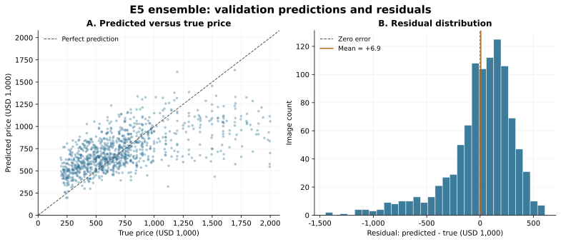

# Phase 5 — Member A Error Analysis

**Project:** COMP90086 — Predicting House Prices  
**Member A:** Mingyang Sun  
**Plan:** feedback-revised Phase 1–8 plan; Phase 5 target 18 October 2026  
**Repository reviewed:** `ae74826454627addbeabdec5905595a9599fc105`  
**Prepared and executed:** 17 October 2026  
**Analysis target:** E5, the existing equal-weight E2/E3/E4 ensemble  
**Status:** numerical analysis, example selection, figures and report text completed. The original example photos still need local rendering and visual review.

## 1. Scope and evidence

This completes Member A's price-range analysis and numerical selection of
successful, overestimated and underestimated validation examples. The final
report can use the short [report section](report/Phase5_Error_Analysis_Section.md).
Member B's training-history interpretation remains a separate contribution.

The current repository includes the merged Phase 4 work and Member B's
executed audit. Its handoff names
`evidence/phase4_run_20261016T124243_097811Z/validation_ensemble.csv` as the
Phase 5 input. The analysis follows that handoff. The old `src/error_analysis.py`
defaults to E3 and is retained as a single-model reference. [E1]

The new analysis joins every prediction by **imageid**, checks the 7,000/1,000
disjoint split, verifies each true price and the identity of every input,
and checks that all 1,000 E5 predictions equal the mean of their E2/E3/E4
components rounded to one decimal. Residuals are recomputed from true and
predicted prices; separately rounded residual columns are not reused. [E2]

All results below are **new calculations from the stored prediction CSVs**.
They are not a new training run or a checkpoint-to-prediction reproduction.
E5 is the analysis target recorded in the Phase 4 handoff; this document does
not supply either member's manual model-approval signature. [E1–E2]

## 2. Overall performance and the effect of averaging

| Measure | E5 exported predictions |
|---|---:|
| Validation images | 1,000 |
| MSE | 95,852.002676 |
| RMSE | 309.599746 |
| MAE | 226.423020 |
| R² | 0.379296 |
| Mean signed error, predicted minus true | +6.912374 |
| Overestimates / underestimates | 594 / 406 |

Prices, errors, RMSE and MAE are in **USD 1,000**. MSE is in
**(USD 1,000)²**; R² and proportions have no unit. For example, MAE 226.42
means an average absolute error of about USD 226,423. The small overall bias
does not imply accurate individual predictions: opposite signed errors can
cancel in the average. [E2]

The E3 reference has recomputed MSE **99,051.197058**. E5 lowers this by
**3.23%**, with smaller absolute errors on **515** validation images and larger
errors on **485**. There are no ties. The benefit is an aggregate result,
not a uniform improvement across examples or price ranges. [E2]

The Phase 4 unrounded mean has MSE **95,850.620431**. The Phase 5 value is
**95,852.002676** because it uses the existing one-decimal export convention.
Neither number reconstructs predictions before the component CSVs were rounded.
The small precision difference is not a new experiment. [E1–E2]

*Figure 1. E5 predictions and residuals for all 1,000 validation images. The
identity line indicates perfect prediction; negative residuals indicate
underestimation. No test labels are used.*

## 3. Where the errors are concentrated

The ten diagnostic groups use linear quantiles of the **true validation
prices**, with duplicate boundaries collapsed and the final boundary included.
Equal prices remain in the same group, so group counts are not necessarily
100. These groups describe the fixed predictions; they are not model inputs
or a newly tuned decision rule. Exact boundaries and all ten rows are in
[price_buckets.csv](evidence/phase5_run_20261017/price_buckets.csv). [E2]

| True-price group (USD 1,000) | Images | Mean signed error | Share of total squared error |
|---|---:|---:|---:|
| Lowest 30%: 195 ≤ price < 479.997 | 300 | +222.03 | 21.19% |
| Middle 50%: 479.997 ≤ price < 940.92 | 500 | +46.27 | 16.81% |
| Ninth decile: 940.92 ≤ price < 1299.91 | 100 | −179.81 | 8.86% |
| Highest 10%: 1299.91 ≤ price ≤ 1999.9 | 100 | **−648.48** | **53.14%** |

The lowest-price groups are systematically overestimated. The highest-price
group is systematically underestimated and accounts for more than half of
the total squared error. The highest 20% together account for **62.00%**.
The middle 50% contribute **16.81%**, but their errors remain relevant to
individual predictions and the total MSE. [E2]

The sixth group, from **639.45 to below 718.9328**, has the lowest MAE:
**115.56**. Its bias is **+15.59**. In contrast, the highest group has MAE
**650.21** and MSE **509,349.70**. In this highest group, E3's MSE is
**488,255.36**: E5 is **4.32% worse**. The ensemble's overall gain therefore
coexists with a larger error in the expensive tail. [E2]

*Figure 2. Absolute error, signed bias, contribution to squared error and
mean prices for the same diagnostic groups. D01–D10 are ordered by true
price. A larger share of total squared error reflects both the group size
and its squared errors; it is not the group's fraction of images.*

## 4. Selected examples

The selection rule is fixed before visual inspection: the three smallest
absolute errors, the three largest positive residuals, and the three most
negative residuals. Ties use imageid order and categories are disjoint.
These are deliberately selected examples, not a random sample or an estimate
of typical performance. Full rows are in
[representative_examples.csv](evidence/phase5_run_20261017/representative_examples.csv).

| Category | imageid | True price | Predicted price | Residual |
|---|---|---:|---:|---:|
| Closest prediction 1 | 751.jpg | 759.0 | 758.2 | −0.8 |
| Closest prediction 2 | 1770.jpg | 599.0 | 600.8 | +1.8 |
| Closest prediction 3 | 5703.jpg | 650.0 | 648.2 | −1.8 |
| Largest overestimate 1 | 3947.jpg | 420.0 | 1026.7 | +606.7 |
| Largest overestimate 2 | 3709.jpg | 629.9 | 1235.8 | +605.9 |
| Largest overestimate 3 | 1416.jpg | 485.0 | 1054.5 | +569.5 |
| Largest underestimate 1 | 1977.jpg | 1995.0 | 545.9 | −1449.1 |
| Largest underestimate 2 | 2138.jpg | 1995.0 | 577.2 | −1417.8 |
| Largest underestimate 3 | 7737.jpg | 1999.0 | 700.2 | −1298.8 |

All prices and residuals are in USD 1,000. The first group supplies examples
of numerically accurate predictions; a small error alone does not establish
that the model used the intended visual features. [E2]

The original photos were not available in the preparation environment.
Consequently, this document makes **no image-specific claim** about lighting,
occlusion, architecture, landscaping or image quality. The plotting helper
loads these exact nine files from the local course `train/` folder, preserves
their aspect ratios, labels them with their real prices/errors, and creates
a visual-review CSV. Its generation command appears in the README and the
[completion guide](Phase5_Verification.md).

## 5. Interpretation, limitations and future work

The price-group means show predictions concentrated in a narrower range than
the true prices. This pattern is consistent with a tendency toward central
prices, but it does not isolate the cause. A single exterior photo may omit
information relevant to sale price, while representation limits, the training
distribution, regularisation and fitting choices could also contribute.
The CSV analysis cannot decide between these explanations. [E2–E4]

The squared-error metric gives large individual residuals a large contribution
to MSE. That explains the arithmetic of the observed error concentration;
it does not prove that the MSE objective or target skew caused the residuals.
There is also no basis here to claim that the architecture has reached its
limit or that changing the loss will necessarily improve the course metric.

These results describe **one validation split**, which was already used for
model development and checkpoint selection. They are not an independent test
estimate, a significance test or a repeated-seed result. The selected example
photos require visual review. The analysis also cannot infer E5 overfitting
from E3's training history: the ensemble has three component histories and no
single joint training curve. [E1–E3]

The evidence motivates the following possible experiments after this analysis:

1. Compare the original target with a log target or another training objective,
   then evaluate predictions in original USD-1,000 units using the required MSE.
   Better relative error need not imply better original-unit MSE.
2. Compare a carefully specified sampling or weighting policy with the existing
   one. Report both overall MSE and price-group errors, since improving expensive
   houses could worsen other groups.
3. Test whether preserving useful spatial information or revising the visual
   representation improves the difficult groups under a controlled protocol.
   Check actual example images before proposing a specific visual failure mode.

These are proposals, not experiments executed in Phase 5. Member B can combine
the numerical findings with the original component training logs and the
completed visual review when finalising the explanation and future-work text.

## 6. Historical E3 corrections carried forward

The earlier E3 summary called the interval approximately 480–941 the
"middle 4 deciles". It actually covers **five groups and 500 images**.
The cited narrow bias range also omitted the fourth and fifth groups, whose
historical biases are approximately +119.7 and +125.6. The README now presents
the correctly grouped E5 result; the experiment log retains the E3 table with
these interpretation corrections. [E3]

## Evidence references

- **[E1]** [Phase 4 model selection and Member B handoff](Phase4_Model_Selection.md),
  section 7; [executed comparison](evidence/phase4_run_20261016T124243_097811Z/comparison.md).
- **[E2]** [Executed Phase 5 analysis](evidence/phase5_run_20261017/analysis.md),
  [summary and input hashes](evidence/phase5_run_20261017/summary.json),
  [per-image errors](evidence/phase5_run_20261017/per_image_errors.csv),
  generated by [analyze_phase5_errors.py](../tools/analyze_phase5_errors.py).
- **[E3]** [Experiment log](experiments.md#phase-5--error-analysis) and the
  committed E3 prediction CSV; historical training claims were not rerun here.
- **[E4]** Supplied `COMP90086_2026_Project.pdf`, pp. 1–3: exterior-photo task,
  USD-1,000 targets and the requirement to explain successes, failures and
  potential improvements. The dataset's image variation is described by the
  specification; it is not an observation of the nine unavailable photos.
